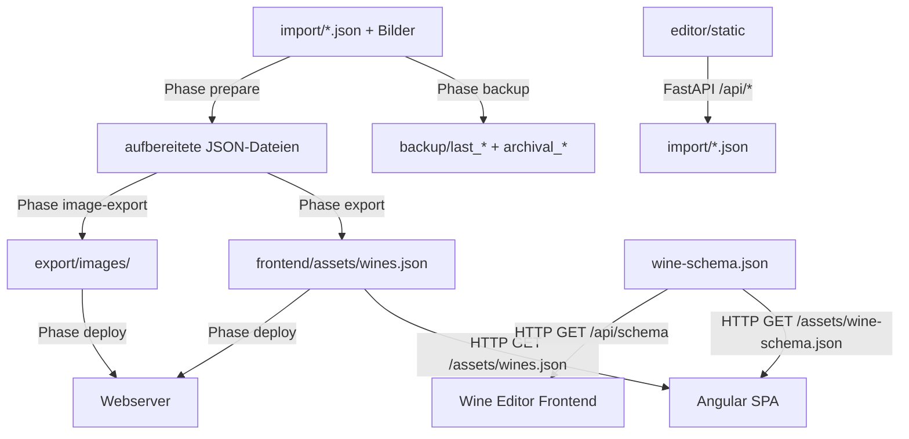

# Design Document: Weinsprechstunde

## Overview

„Weinsprechstunde" besteht aus drei voneinander unabhängigen Subsystemen:

1. **Python Import-Skript** (`scripts/weinimport.py`) — ein phasenbasiertes CLI, das JSON-Quelldateien aus dem Import-Ordner aufbereitet, eine fertige `wines.json` exportiert, Bilder skaliert und Artefakte optional auf einen Webserver deployt. Vor der Pipeline kann ein Zwei-Tier-Backup erstellt und bei Bedarf der Import-Ordner per FTP/SFTP vom Webserver heruntergeladen werden.
2. **Angular SPA Frontend** (`frontend/`) — liest die fertig generierte `wines.json` sowie die zentrale `wine-schema.json` und stellt Weine in Kachel- oder Listenansicht mit dynamischer, schema-gesteuerter Filterkonfiguration und URL-basiertem Routing dar.
3. **Wine Editor Web-App** (`editor/`) — eine passwortgeschützte FastAPI-Anwendung mit Vanilla-HTML/JS-Frontend zur komfortablen Pflege der JSON-Quelldateien im Import-Ordner. Nutzt ebenfalls `wine-schema.json` für dynamische Formularfelder.

Die drei Subsysteme teilen sich zwei zentrale Konfigurationsdateien im Projekt-Root:
- `weinsprechstunde.config.json` — Laufzeitparameter (Pfade, Deploy, Backup, Editor)
- `wine-schema.json` — Felddefinitionen aller bekannten Weinattribute (Typ, Filter-Typ, Sichtbarkeit)

Laufzeitabhängigkeiten zwischen den Subsystemen existieren nicht.

---

## Architecture

```
weinsprechstunde2/
├── weinsprechstunde.config.json      ← zentrale Laufzeit-Konfiguration
├── wine-schema.json                  ← zentrale Felddefinitionen (shared)
├── Makefile                          ← Build-Targets
├── .github/
│   └── workflows/
│       └── deploy.yml               ← GitHub Actions CI/CD
├── scripts/
│   ├── weinimport.py                ← Python CLI (backup/prepare/export/image-export/deploy)
│   ├── hash_password.py             ← Hilfsskript: Passwort hashen
│   └── requirements.txt
├── import/                          ← Quelldaten (JSON + Bilder + Audio + Video)
├── backup/                          ← lokale Backups (last_* + archival_* + .last_archival)
├── export/
│   └── images/                      ← skalierte Exportbilder (generiert)
├── frontend/                        ← Angular SPA
│   ├── src/
│   │   └── assets/
│   │       ├── wines.json           ← generiert von Phase export
│   │       └── wine-schema.json     ← Kopie/Symlink von Projekt-Root
│   └── package.json
└── editor/                          ← Wine Editor
    ├── main.py                      ← FastAPI Backend
    └── static/                      ← HTML/JS/CSS Frontend
```

```
┌──────────────────────────────────────────────────────────────────────┐
│  Build-Zeit (Python Import-Skript)                                   │
│                                                                      │
│  [Phase backup]  ─►  backup/last_*  +  backup/archival_*            │
│       ↓                                                              │
│  [optional] Remote-Import-Download (SFTP/FTP)                        │
│       ↓                                                              │
│  import/                                                             │
│  ├── wein-a.json  ─┐  [Phase prepare]  ─►  aufbereitete JSON-Dateien │
│  ├── wein-a.jpg   ─┤  [Phase export]   ─►  frontend/assets/         │
│  └── 2021/        │                          wines.json              │
│      └── wein-b.json┘  [Phase image-export] ─►  export/images/      │
│                         [Phase deploy]  ─►  Webserver (FTP/SFTP)    │
└──────────────────────────────────────────────────────────────────────┘

┌──────────────────────────────────────────────────────────────────────┐
│  Browser: Angular SPA                                                │
│                                                                      │
│  AppComponent (Router Outlet)                                        │
│  ├── NavComponent (Regionen/Rebsorten Dropdowns)                    │
│  └── WineWallComponent (Route: /, /region/:slug, /rebsorte/:slug)   │
│      ├── ControlsRowComponent (Filter via WineSchema, Toggles)      │
│      ├── WineGridComponent  (Kacheln + EndlessScroll)               │
│      └── WineListComponent  (Liste  + EndlessScroll)                │
│  WineDetailDialogComponent (modal, global in AppComponent)          │
│                                                                      │
│  Services: WineDataService · FilterService · UserPreferencesService  │
└──────────────────────────────────────────────────────────────────────┘

┌──────────────────────────────────────────────────────────────────────┐
│  Browser: Wine Editor (FastAPI + Vanilla JS)                         │
│                                                                      │
│  editor/static/index.html  ←──►  FastAPI /api/*                     │
│  editor/static/edit.html         liest/schreibt import/             │
│  (Formularfelder dynamisch aus wine-schema.json)                     │
└──────────────────────────────────────────────────────────────────────┘
```

### Data Flow



---

## Central Configuration Files

### `weinsprechstunde.config.json`

```json
{
  "import_dir": "./import",
  "import_source": "local",
  "export_path": "./frontend/src/assets/wines.json",
  "scaffold_mode": true,
  "image_export_dir": "./export/images",
  "image_resize_mode": "width",
  "image_resize_px": 1200,
  "deploy": {
    "protocol": "sftp",
    "host": "example.com",
    "user": "myuser",
    "password": "",
    "remote_path": "/var/www/html",
    "remote_images_path": "/var/www/images",
    "remote_import_path": "/var/www/import"
  },
  "backup": {
    "backup_dir": "./backup",
    "remote_backup_dir": "/var/www/backup",
    "max_last_backups": 10,
    "max_archival_backups": 24,
    "archival_interval_days": 30
  },
  "editor": {
    "path": "/editor-geheim",
    "password_hash": "$2b$12$..."
  }
}
```

### `wine-schema.json`

Definiert alle bekannten Weinattribute mit Datentyp, Filter-Typ und ob sie standardmäßig als Filter angezeigt werden. Wird von Python-Skript, Angular-Frontend und Wine-Editor gemeinsam genutzt.

```json
[
  { "field": "name",         "type": "text",        "filter_type": "text-search",  "default_filter": true  },
  { "field": "year",         "type": "number",       "filter_type": "range",        "default_filter": false },
  { "field": "country",      "type": "text",         "filter_type": "dropdown",     "default_filter": false },
  { "field": "origin",       "type": "text",         "filter_type": "dropdown",     "default_filter": false },
  { "field": "grape",        "type": "multi-value",  "filter_type": "multi-select", "default_filter": true  },
  { "field": "type",         "type": "text",         "filter_type": "dropdown",     "default_filter": false },
  { "field": "producer",     "type": "text",         "filter_type": "dropdown",     "default_filter": false },
  { "field": "quality",      "type": "text",         "filter_type": "dropdown",     "default_filter": false },
  { "field": "price",        "type": "text",         "filter_type": null,           "default_filter": false },
  { "field": "rating",       "type": "rating",       "filter_type": "rating-range", "default_filter": true  },
  { "field": "tasting_date", "type": "date",         "filter_type": "date-range",   "default_filter": true  },
  { "field": "image",        "type": "text",         "filter_type": null,           "default_filter": false },
  { "field": "audio",        "type": "text",         "filter_type": null,           "default_filter": false },
  { "field": "video",        "type": "text",         "filter_type": null,           "default_filter": false },
  { "field": "description",  "type": "text",         "filter_type": null,           "default_filter": false }
]
```

---

## Components and Interfaces

### 1. Python Import-Skript (`scripts/weinimport.py`)

#### Einstiegspunkt (argparse)

| Aufruf | Verhalten |
|---|---|
| `python weinimport.py` | Führt backup → (remote-download) → prepare → export → image-export sequenziell aus |
| `python weinimport.py backup` | Nur Phase backup |
| `python weinimport.py prepare` | Nur Phase prepare |
| `python weinimport.py export` | Nur Phase export |
| `python weinimport.py image-export` | Nur Phase image-export |
| `python weinimport.py deploy` | Nur Phase deploy |

#### Konfiguration laden

```python
def load_config(path: str = "weinsprechstunde.config.json") -> Config:
    try:
        with open(path) as f:
            raw = json.load(f)
    except FileNotFoundError:
        sys.stderr.write(f"FEHLER: Konfigurationsdatei '{path}' nicht gefunden.\n")
        sys.exit(1)
    except json.JSONDecodeError as e:
        sys.stderr.write(f"FEHLER: Konfigurationsdatei ist kein valides JSON: {e}\n")
        sys.exit(1)
    return Config(**raw)

def load_wine_schema(path: str = "wine-schema.json") -> list[SchemaField]:
    try:
        with open(path) as f:
            raw = json.load(f)
    except FileNotFoundError:
        sys.stderr.write(f"FEHLER: wine-schema.json nicht gefunden.\n")
        sys.exit(1)
    return [SchemaField(**entry) for entry in raw]

def get_scaffold_fields(schema: list[SchemaField]) -> list[str]:
    return [f.field for f in schema]
```

#### Hilfsfunktionen

```python
def collect_json_files(import_dir: str) -> list[Path]:
    """Rekursiv alle .json-Dateien in import_dir erfassen."""
    return sorted(Path(import_dir).rglob("*.json"))

def slugify_name(name: str) -> str:
    """Name → URL-freundlicher Slug (python-slugify)."""
    from slugify import slugify
    return slugify(name)

def find_image_sibling(json_path: Path) -> str | None:
    """Bilddatei mit gleichem Basisnamen im selben Verzeichnis suchen."""
    for ext in (".jpg", ".jpeg", ".png", ".webp"):
        candidate = json_path.with_suffix(ext)
        if candidate.exists():
            return candidate.name
    return None

def read_exif_date(image_path: Path) -> str | None:
    """EXIF DateTimeOriginal → ISO-8601-Datumsstring (piexif)."""
    try:
        import piexif
        exif = piexif.load(str(image_path))
        dt_bytes = exif["Exif"].get(piexif.ExifIFD.DateTimeOriginal)
        if dt_bytes:
            dt_str = dt_bytes.decode()   # "YYYY:MM:DD HH:MM:SS"
            return dt_str[:10].replace(":", "-")
    except Exception:
        pass
    return None

def resolve_password(config: Config) -> str:
    """Passwort aus Config oder Umgebungsvariable lesen."""
    password = config.deploy.password
    if not password:
        password = os.environ.get("WEINSPRECHSTUNDE_DEPLOY_PASSWORD", "")
        if not password:
            sys.stderr.write(
                "FEHLER: Kein Deploy-Passwort gefunden. Setze die Umgebungsvariable "
                "WEINSPRECHSTUNDE_DEPLOY_PASSWORD mit dem Server-Passwort, z. B.: "
                "export WEINSPRECHSTUNDE_DEPLOY_PASSWORD=deinPasswort\n"
            )
            sys.exit(1)
    return password
```

---

#### Phase `backup`

Zwei-Tier-Backup-System: **Last-Backups** werden bei jedem Lauf erstellt und bewahren die letzten `max_last_backups` Builds. **Archival-Backups** werden nur erstellt, wenn mindestens `archival_interval_days` Tage seit dem letzten Archival vergangen sind, und bewahren die letzten `max_archival_backups` Snapshots. Der Zeitstempel des letzten Archival-Backups wird in `backup/.last_archival` gespeichert.

```python
from datetime import datetime, timedelta
import shutil

LAST_ARCHIVAL_FILE = ".last_archival"

def phase_backup(config: Config) -> None:
    if not config.backup:
        return

    backup_dir = Path(config.backup.backup_dir)
    backup_dir.mkdir(parents=True, exist_ok=True)
    timestamp = datetime.now().strftime("%Y-%m-%d_%H-%M-%S")

    # Last-Backup: bei jedem Lauf
    last_name = f"last_{timestamp}"
    last_path = backup_dir / last_name
    try:
        shutil.copytree(config.import_dir, last_path)
    except Exception as e:
        sys.stderr.write(f"WARNUNG: Last-Backup fehlgeschlagen: {e}\n")

    _prune_backups(backup_dir, prefix="last_", max_count=config.backup.max_last_backups)

    # Archival-Backup: nur wenn Intervall abgelaufen
    last_archival_path = backup_dir / LAST_ARCHIVAL_FILE
    archival_due = True
    if last_archival_path.exists():
        last_ts = datetime.fromisoformat(last_archival_path.read_text().strip())
        if datetime.now() - last_ts < timedelta(days=config.backup.archival_interval_days):
            archival_due = False

    archival_name = None
    if archival_due:
        archival_name = f"archival_{timestamp}"
        archival_path = backup_dir / archival_name
        try:
            shutil.copytree(config.import_dir, archival_path)
            last_archival_path.write_text(datetime.now().isoformat())
        except Exception as e:
            sys.stderr.write(f"WARNUNG: Archival-Backup fehlgeschlagen: {e}\n")
            archival_name = None

        _prune_backups(backup_dir, prefix="archival_", max_count=config.backup.max_archival_backups)

    # Remote-Backups wenn konfiguriert
    if config.backup.remote_backup_dir and config.deploy:
        _remote_backup(config, last_name, archival_name)

def _prune_backups(backup_dir: Path, prefix: str, max_count: int) -> None:
    """Älteste Backup-Ordner löschen wenn max_count überschritten."""
    entries = sorted(
        [d for d in backup_dir.iterdir() if d.is_dir() and d.name.startswith(prefix)]
    )
    while len(entries) > max_count:
        oldest = entries.pop(0)
        try:
            shutil.rmtree(oldest)
        except Exception as e:
            sys.stderr.write(f"WARNUNG: Backup-Ordner {oldest} konnte nicht gelöscht werden: {e}\n")
```

---

#### Remote-Import-Download (wenn `import_source = "remote"`)

```python
def download_remote_import(config: Config, password: str) -> None:
    """
    Synchronisiert deploy.remote_import_path auf lokalen import_dir.
    Bei Fehler: lesbarer Fehler mit Serverpfad + Server-Meldung → abbrechen.
    """
    try:
        if config.deploy.protocol == "sftp":
            _download_sftp(
                host=config.deploy.host,
                user=config.deploy.user,
                password=password,
                remote_path=config.deploy.remote_import_path,
                local_path=Path(config.import_dir),
            )
        else:
            _download_ftp(
                host=config.deploy.host,
                user=config.deploy.user,
                password=password,
                remote_path=config.deploy.remote_import_path,
                local_path=Path(config.import_dir),
            )
    except Exception as e:
        sys.stderr.write(
            f"FEHLER: Download des Import-Ordners von {config.deploy.host}:"
            f"{config.deploy.remote_import_path} fehlgeschlagen. "
            f"Server-Meldung: {e}\n"
        )
        sys.exit(1)
```

---

#### Phase `prepare`

```python
def phase_prepare(config: Config, schema: list[SchemaField]) -> None:
    for json_file in collect_json_files(config.import_dir):
        data = json.loads(json_file.read_text(encoding="utf-8"))
        if "name" not in data:
            sys.stderr.write(f"WARNUNG: {json_file} – kein 'name', übersprungen.\n")
            continue

        # 1. Auto-detect image (nur wenn Feld nicht vorhanden)
        if "image" not in data:
            sibling = find_image_sibling(json_file)
            if sibling:
                data["image"] = sibling

        # 2. EXIF → tasting_date (nur wenn nicht vorhanden)
        if "tasting_date" not in data and data.get("image"):
            exif_date = read_exif_date(json_file.parent / data["image"])
            if exif_date:
                data["tasting_date"] = exif_date

        # 3. Umbenennung (braucht nur tasting_date; Datei bleibt im Unterordner)
        if data.get("tasting_date"):
            new_stem = f"{data['tasting_date']}-{slugify_name(data['name'])}"
            rename_file_group(json_file, new_stem, data)
            json_file = json_file.parent / f"{new_stem}.json"
        else:
            sys.stderr.write(f"WARNUNG: {json_file} – kein 'tasting_date', Umbenennung übersprungen.\n")

        # 4. Typ-Normalisierung für number-Felder (year, price, rating, …)
        normalize_number_fields(data, schema, json_file)

        # 5. scaffold_mode anwenden
        apply_scaffold_mode(data, config, schema)
        json_file.write_text(
            json.dumps(data, indent=2, ensure_ascii=False), encoding="utf-8"
        )

def rename_file_group(json_file: Path, new_stem: str, data: dict) -> None:
    """JSON + Bild + Audio auf neuen Basisnamen umbenennen."""
    for field in ("image", "audio"):
        if not data.get(field):
            continue
        old_path = json_file.parent / data[field]
        if not old_path.exists():
            continue
        new_path = old_path.parent / f"{new_stem}{old_path.suffix}"
        if new_path.exists():
            sys.stderr.write(f"WARNUNG: Zieldatei {new_path} existiert bereits, übersprungen.\n")
            continue
        old_path.rename(new_path)
        data[field] = new_path.name

    new_json = json_file.parent / f"{new_stem}.json"
    if new_json.exists() and new_json != json_file:
        sys.stderr.write(f"WARNUNG: Zieldatei {new_json} existiert bereits, übersprungen.\n")
        return
    if new_json != json_file:
        json_file.rename(new_json)

def normalize_number_fields(data: dict, schema: list[SchemaField], json_file: Path) -> None:
    """Felder mit WineSchema-Typ 'number' von String zu Zahl normalisieren.

    - Dezimal-Komma → Dezimalpunkt ("6,99" → "6.99")
    - decimals == 0 → Integer (year: "2017" → 2017)
    - decimals == 1 → Float, 1 Nachkommastelle (rating: "6" → 6.0)
    - decimals == 2 → Float, 2 Nachkommastellen (price: "6,99" → 6.99)
    Nicht umwandelbare Werte bleiben unverändert und erzeugen eine Warnung.
    """
    number_fields = {f.field: f for f in schema if f.type == "number"}
    for field, spec in number_fields.items():
        if field not in data:
            continue
        value = data[field]
        if value is None or isinstance(value, (int, float)):
            # bereits numerisch oder leer → nur ggf. auf decimals runden
            if isinstance(value, (int, float)):
                data[field] = _round_to_decimals(value, spec.decimals)
            continue
        if not isinstance(value, str) or value.strip() == "":
            continue
        raw = value.strip().replace(",", ".")
        try:
            parsed = float(raw)
        except ValueError:
            sys.stderr.write(
                f"WARNUNG: {json_file} – Feld '{field}' Wert '{value}' ist keine Zahl, "
                f"unverändert belassen.\n"
            )
            continue
        data[field] = _round_to_decimals(parsed, spec.decimals)


def _round_to_decimals(value: float, decimals: int | None) -> int | float:
    """Auf die konfigurierte Nachkommastellen-Anzahl normalisieren."""
    if decimals is None:
        return value
    if decimals == 0:
        return int(round(value))
    return round(float(value), decimals)


def apply_scaffold_mode(data: dict, config: Config, schema: list[SchemaField]) -> None:
    scaffold_fields = get_scaffold_fields(schema)
    if config.scaffold_mode:
        for field in scaffold_fields:
            if field not in data:
                data[field] = None
        # bestehende Nicht-null-Werte bleiben unverändert
    else:
        keys_to_remove = [k for k, v in data.items() if v is None or v == ""]
        for k in keys_to_remove:
            del data[k]
```

---

#### Phase `export`

```python
def phase_export(config: Config) -> None:
    wines = []
    for json_file in collect_json_files(config.import_dir):
        data = json.loads(json_file.read_text(encoding="utf-8"))
        if "name" not in data:
            sys.stderr.write(f"WARNUNG: {json_file} – kein 'name', übersprungen.\n")
            continue
        wines.append(data)

    with_date    = sorted(
        [w for w in wines if w.get("tasting_date")],
        key=lambda w: w["tasting_date"],
        reverse=True
    )
    without_date = [w for w in wines if not w.get("tasting_date")]

    output_path = Path(config.export_path)
    output_path.parent.mkdir(parents=True, exist_ok=True)
    output_path.write_text(
        json.dumps(with_date + without_date, indent=2, ensure_ascii=False),
        encoding="utf-8"
    )
```

---

#### Phase `image-export`

```python
def phase_image_export(config: Config) -> None:
    from PIL import Image

    for json_file in collect_json_files(config.import_dir):
        data = json.loads(json_file.read_text(encoding="utf-8"))
        image_ref = data.get("image")
        if not image_ref:
            continue

        src = json_file.parent / image_ref
        if not src.exists():
            sys.stderr.write(f"WARNUNG: Bild {src} nicht gefunden, übersprungen.\n")
            continue

        dst = Path(config.image_export_dir) / image_ref
        dst.parent.mkdir(parents=True, exist_ok=True)

        # Timestamp-Vergleich: überspringen wenn Kopie aktuell
        if dst.exists() and dst.stat().st_mtime >= src.stat().st_mtime:
            continue

        with Image.open(src) as img:
            px = config.image_resize_px
            if config.image_resize_mode == "width":
                img.thumbnail((px, 99999))
            else:  # "height"
                img.thumbnail((99999, px))
            img.save(dst, format=img.format)
        # Originale werden nicht verändert
```

---

#### Phase `deploy`

```python
def phase_deploy(config: Config) -> None:
    password = resolve_password(config)

    try:
        if config.deploy.protocol == "sftp":
            _deploy_sftp(config, password)
        else:
            _deploy_ftp(config, password)
    except Exception as e:
        sys.stderr.write(
            f"FEHLER: Verbindung zum Server {config.deploy.host} fehlgeschlagen. "
            f"Server-Meldung: {e}. "
            f"Bitte prüfe: (1) Ist der Hostname '{config.deploy.host}' korrekt? "
            f"(2) Sind Benutzername und Passwort gültig? "
            f"(3) Ist der Server erreichbar und das Protokoll ({config.deploy.protocol}) korrekt?\n"
        )
        sys.exit(1)
```

Deploy-Logik:
- Angular-dist-Ordner: veraltete Serverdateien löschen (via SFTP `listdir` / FTP `NLST`)
- `wines.json` und Bilder aus `image_export_dir`: **niemals** auf dem Server löschen
- Timestamp-Vergleich: SFTP via `stat().st_mtime`, FTP via `MDTM`
- Zugangsdaten ausschließlich über Umgebungsvariablen — niemals im Klartext in Config

---

#### GitHub Actions Workflow (`.github/workflows/deploy.yml`)

```yaml
name: Deploy Weinsprechstunde

on:
  push:
    branches: [main]

jobs:
  deploy:
    runs-on: ubuntu-latest
    steps:
      - uses: actions/checkout@v4

      - uses: actions/setup-python@v5
        with:
          python-version: '3.12'

      - uses: actions/setup-node@v4
        with:
          node-version: '20'

      - name: Install Python dependencies
        run: pip install -r scripts/requirements.txt

      - name: Install Node dependencies
        run: npm ci
        working-directory: frontend

      - name: Run import pipeline
        env:
          WEINSPRECHSTUNDE_DEPLOY_PASSWORD: ${{ secrets.WEINSPRECHSTUNDE_DEPLOY_PASSWORD }}
        run: python scripts/weinimport.py prepare export image-export

      - name: Build Angular
        run: npm run build
        working-directory: frontend

      - name: Deploy to server
        env:
          WEINSPRECHSTUNDE_DEPLOY_PASSWORD: ${{ secrets.WEINSPRECHSTUNDE_DEPLOY_PASSWORD }}
        run: python scripts/weinimport.py deploy
```

> Wenn `import_source = "remote"`: Das Import-Skript lädt den Import-Ordner beim Start von `prepare` automatisch via FTP/SFTP herunter, bevor Phase prepare beginnt. Der CI-Workflow bleibt gleich.

**Python-Bibliotheken (`scripts/requirements.txt`):**

| Bibliothek | Zweck |
|---|---|
| `Pillow` | Bildskalierung in Phase image-export |
| `piexif` | EXIF-Auslesen für tasting_date |
| `paramiko` | SFTP-Verbindung in Phase deploy + Remote-Download |
| `ftplib` (stdlib) | FTP-Verbindung in Phase deploy + Remote-Download |
| `python-slugify` | Slug-Generierung für Dateinamen |
| `dataclasses` (stdlib) | Datenmodelle |
| `argparse` (stdlib) | CLI-Einstiegspunkt |
| `bcrypt` | Passwort-Hashing für Wine Editor |
| `itsdangerous` | Session-Cookie-Signing für Wine Editor |

---

### 2. Angular Frontend (`frontend/`)

#### Router-Konfiguration

Alle drei Routen rendern dieselbe `WineWallComponent`. Kein Datennachladen bei Routenwechseln — `WineWallComponent` liest Route-Parameter und aktualisiert den `FilterService`.

```typescript
// app.routes.ts
export const routes: Routes = [
  { path: '',               component: WineWallComponent },
  { path: 'region/:slug',   component: WineWallComponent },
  { path: 'rebsorte/:slug', component: WineWallComponent },
  { path: '**',             redirectTo: '' }
];
```

#### Komponentenstruktur

```
AppComponent
├── NavComponent
│   ├── Dropdown "Regionen" (aus FilterService.availableRegions)
│   └── Dropdown "Rebsorten" (aus FilterService.availableGrapes)
└── WineWallComponent (liest Route-Parameter, initialisiert FilterService)
    ├── ControlsRowComponent
    │   ├── FilterFieldComponent (×n, dynamisch aus WineSchema)
    │   ├── MoreFiltersButtonComponent
    │   ├── SortControlComponent
    │   ├── InfoToggleComponent
    │   └── ListToggleComponent
    ├── WineGridComponent
    │   ├── BackButtonTileComponent (nur wenn hasActiveFilter())
    │   └── WineTileComponent (×n, EndlessScroll)
    │       ├── WineTileCoverComponent
    │       ├── WineTileOverlayComponent (festes Template)
    │       └── PlayButtonComponent (wenn audio/video vorhanden)
    └── WineListComponent
        ├── BackButtonItemComponent (nur wenn hasActiveFilter())
        └── WineListItemComponent (×n, EndlessScroll)
WineDetailDialogComponent (modal, festes Template in Gruppen)
```

#### Services

```typescript
// WineDataService — lädt wines.json und wine-schema.json einmalig, parallel
@Injectable({ providedIn: 'root' })
export class WineDataService {
  private readonly http = inject(HttpClient);

  readonly wines = signal<Wine[]>([]);
  readonly schema = signal<WineSchemaField[]>([]);
  readonly loadState = signal<LoadState>('idle');

  loadAll(): void {
    if (this.loadState() !== 'idle') return;
    this.loadState.set('loading');
    forkJoin({
      wines:  this.http.get<Wine[]>('/assets/wines.json'),
      schema: this.http.get<WineSchemaField[]>('/assets/wine-schema.json'),
    }).pipe(
      catchError(() => { this.loadState.set('error'); return EMPTY; })
    ).subscribe(({ wines, schema }) => {
      this.wines.set(wines);
      this.schema.set(schema);
      this.loadState.set('loaded');
    });
  }
}
```

```typescript
// FilterService — einzige Quelle der Wahrheit für alle Filter, Sortierung, Ansicht
@Injectable({ providedIn: 'root' })
export class FilterService {
  private readonly wineData = inject(WineDataService);
  private readonly prefs    = inject(UserPreferencesService);

  // Zustand
  readonly filter              = signal<WineFilter>(EMPTY_FILTER);
  readonly navigationFilter    = signal<NavigationFilter | null>(null);
  readonly sortOption          = signal<SortOption>('tasting_date_desc');
  readonly viewMode            = signal<'grid' | 'list'>('grid');
  readonly infoToggleActive    = signal<boolean>(false);
  readonly visibleFilterFields = signal<string[]>([]);  // aus Cookie

  constructor() {
    const saved = this.prefs.load();
    this.sortOption.set(saved.sortOption);
    this.viewMode.set(saved.viewMode);
    this.visibleFilterFields.set(saved.visibleFilters);
  }

  // Berechnete Werte
  readonly filteredWines = computed(() =>
    applyFiltersAndSort(
      this.wineData.wines(),
      this.filter(),
      this.navigationFilter(),
      this.sortOption()
    )
  );

  readonly availableRegions = computed(() => {
    const counts = new Map<string, number>();
    for (const w of this.wineData.wines()) {
      if (w.origin) counts.set(w.origin, (counts.get(w.origin) ?? 0) + 1);
    }
    return [...counts.entries()]
      .sort((a, b) => a[0].localeCompare(b[0]))
      .map(([value, count]) => ({ value, count }));
  });

  readonly availableGrapes = computed(() => {
    const counts = new Map<string, number>();
    for (const w of this.wineData.wines()) {
      const grapes = Array.isArray(w.grape) ? w.grape : (w.grape ? [w.grape] : []);
      for (const g of grapes) counts.set(g, (counts.get(g) ?? 0) + 1);
    }
    return [...counts.entries()]
      .sort((a, b) => a[0].localeCompare(b[0]))
      .map(([value, count]) => ({ value, count }));
  });

  readonly availableCountries = computed(() =>
    [...new Set(this.wineData.wines().map(w => w.country).filter(Boolean))] as string[]
  );

  readonly hasActiveFilter = computed(() =>
    this.navigationFilter() !== null ||
    this.filter().searchText !== '' ||
    Object.values(this.filter()).some(v => v !== null && v !== '')
  );

  setNavigationFilter(type: 'region' | 'rebsorte', slug: string): void {
    this.navigationFilter.set({ type, slug });
  }

  clearNavigationFilter(): void {
    this.navigationFilter.set(null);
  }

  clearAllFilters(): void {
    this.filter.set(EMPTY_FILTER);
    this.navigationFilter.set(null);
  }

  setSortOption(opt: SortOption): void {
    this.sortOption.set(opt);
    this._savePrefs();
  }

  setViewMode(mode: 'grid' | 'list'): void {
    this.viewMode.set(mode);
    this._savePrefs();
  }

  toggleFilterField(field: string, visible: boolean): void {
    const current = this.visibleFilterFields();
    const updated = visible
      ? [...current, field]
      : current.filter(f => f !== field);
    this.visibleFilterFields.set(updated);
    this._savePrefs();
  }

  private _savePrefs(): void {
    this.prefs.save({
      visibleFilters: this.visibleFilterFields(),
      sortOption: this.sortOption(),
      viewMode: this.viewMode(),
    });
  }
}

/** Pure Funktion — einfach unit-testbar */
export function applyFiltersAndSort(
  wines: Wine[],
  filter: WineFilter,
  navFilter: NavigationFilter | null,
  sort: SortOption
): Wine[] {
  const filtered = wines.filter(wine => {
    // Navigation-Filter (region oder rebsorte per Slug)
    if (navFilter) {
      const slug = (s: string) => s.toLowerCase().replace(/\s+/g, '-');
      if (navFilter.type === 'region') {
        if (!wine.origin || slug(wine.origin) !== navFilter.slug) return false;
      } else {
        const grapes = Array.isArray(wine.grape) ? wine.grape : (wine.grape ? [wine.grape] : []);
        if (!grapes.some(g => slug(g) === navFilter.slug)) return false;
      }
    }
    // Freitextsuche (case-insensitiv, text-search-Felder laut WineSchema)
    if (filter.searchText) {
      const q = filter.searchText.toLowerCase();
      const grapeStr = Array.isArray(wine.grape) ? wine.grape.join(' ') : (wine.grape ?? '');
      const matches =
        wine.name.toLowerCase().includes(q) ||
        String(wine.year ?? '').includes(q) ||
        grapeStr.toLowerCase().includes(q) ||
        (wine.producer ?? '').toLowerCase().includes(q) ||
        (wine.origin ?? '').toLowerCase().includes(q);
      if (!matches) return false;
    }
    // Dropdown-Filter
    if (filter.country && wine.country !== filter.country) return false;
    if (filter.grape) {
      const grapes = Array.isArray(wine.grape) ? wine.grape : [wine.grape ?? ''];
      if (!grapes.includes(filter.grape)) return false;
    }
    // Range-Filter
    if (filter.yearFrom    != null && (wine.year   == null || wine.year   < filter.yearFrom))   return false;
    if (filter.yearTo      != null && (wine.year   == null || wine.year   > filter.yearTo))     return false;
    if (filter.ratingFrom  != null && (wine.rating == null || wine.rating < filter.ratingFrom)) return false;
    if (filter.ratingTo    != null && (wine.rating == null || wine.rating > filter.ratingTo))   return false;
    if (filter.tastingDateFrom && (wine.tasting_date ?? '') < filter.tastingDateFrom) return false;
    if (filter.tastingDateTo   && (wine.tasting_date ?? '') > filter.tastingDateTo)   return false;
    return true;
  });

  return filtered.slice().sort((a, b) => {
    if (sort === 'tasting_date_asc') {
      return (a.tasting_date ?? '').localeCompare(b.tasting_date ?? '');
    }
    if (sort === 'rating_desc') {
      return (b.rating ?? 0) - (a.rating ?? 0);
    }
    // tasting_date_desc (Standard)
    return (b.tasting_date ?? '').localeCompare(a.tasting_date ?? '');
  });
}
```

```typescript
// UserPreferencesService — Cookie ws_prefs (kein Ablaufdatum)
export interface UserPreferences {
  visibleFilters: string[];
  sortOption: SortOption;
  viewMode: 'grid' | 'list';
}

const COOKIE_NAME = 'ws_prefs';
const DEFAULT_PREFS: UserPreferences = {
  visibleFilters: [],
  sortOption: 'tasting_date_desc',
  viewMode: 'grid',
};

@Injectable({ providedIn: 'root' })
export class UserPreferencesService {
  load(): UserPreferences {
    try {
      const raw = this._getCookieValue(COOKIE_NAME);
      if (!raw) return { ...DEFAULT_PREFS };
      return { ...DEFAULT_PREFS, ...JSON.parse(decodeURIComponent(raw)) };
    } catch {
      return { ...DEFAULT_PREFS };
    }
  }

  save(prefs: UserPreferences): void {
    const value = encodeURIComponent(JSON.stringify(prefs));
    // Kein Max-Age → Session-Cookie (persistent bis Browser-Schließen)
    document.cookie = `${COOKIE_NAME}=${value}; path=/; SameSite=Strict`;
  }

  private _getCookieValue(name: string): string | null {
    const match = document.cookie.match(new RegExp(`(?:^|; )${name}=([^;]*)`));
    return match ? match[1] : null;
  }
}
```

#### WineWallComponent — Route-Integration

```typescript
@Component({ /* … */ })
export class WineWallComponent implements OnInit {
  private readonly route         = inject(ActivatedRoute);
  private readonly filterService = inject(FilterService);

  ngOnInit(): void {
    this.route.params.subscribe(params => {
      if (params['slug']) {
        const path = this.route.snapshot.routeConfig?.path ?? '';
        if (path.startsWith('region')) {
          this.filterService.setNavigationFilter('region', params['slug']);
        } else if (path.startsWith('rebsorte')) {
          this.filterService.setNavigationFilter('rebsorte', params['slug']);
        }
      } else {
        this.filterService.clearNavigationFilter();
      }
    });
  }
}
```

#### WineGridComponent — EndlessScroll + Zurück-Button

```typescript
@Component({ /* … */ })
export class WineGridComponent {
  private readonly filterService = inject(FilterService);
  readonly PAGE_SIZE = 24;
  readonly visibleCount = signal(this.PAGE_SIZE);

  readonly allWines      = this.filterService.filteredWines;
  readonly visibleWines  = computed(() => this.allWines().slice(0, this.visibleCount()));
  readonly showBackButton = this.filterService.hasActiveFilter;

  // IntersectionObserver auf Sentinel-div am Ende
  onSentinelVisible(): void {
    this.visibleCount.update(n => Math.min(n + this.PAGE_SIZE, this.allWines().length));
  }

  // Bei Filteränderung: zurück auf Seite 1
  private readonly _resetOnFilter = effect(() => {
    this.allWines();
    this.visibleCount.set(this.PAGE_SIZE);
  });
}
```

#### WineTileComponent

```typescript
@Component({ /* … */ })
export class WineTileComponent {
  wine       = input.required<Wine>();
  showInfos  = input<boolean>(false);   // InfoToggle-Zustand von außen
  openDetail = output<Wine>();

  private readonly localOverlay = signal(false);
  readonly overlayVisible = computed(() => this.showInfos() || this.localOverlay());
  readonly hasMedia       = computed(() => !!this.wine().audio || !!this.wine().video);

  onMouseEnter(): void { if (!this.showInfos()) this.localOverlay.set(true);  }
  onMouseLeave(): void { if (!this.showInfos()) this.localOverlay.set(false); }
  onTap(): void        { if (!this.showInfos()) this.localOverlay.update(v => !v); }
  onClick(): void      { this.openDetail.emit(this.wine()); }
}
```

**WineTileOverlay** — festes Template (keine dynamische Generierung aus WineSchema):

```html
<div class="overlay">
  @if (wine().rating) {
    <div class="rating-circle">{{ wine().rating }}</div>
  }
  @if (wine().year)     { <div class="wine-year">{{ wine().year }}</div> }
  @if (wine().name)     { <div class="wine-name">{{ wine().name }}</div> }
  @if (wine().producer) { <div class="wine-producer">{{ wine().producer }}</div> }
  @if (wine().grape)    { <div class="wine-grape">{{ grape(wine()) }}</div> }
  @if (wine().origin)   { <div class="wine-origin">{{ wine().origin }}</div> }
</div>
```

#### NavComponent

```typescript
@Component({ /* … */ })
export class NavComponent {
  private readonly router        = inject(Router);
  private readonly filterService = inject(FilterService);

  readonly regionsOpen = signal(false);
  readonly grapesOpen  = signal(false);

  readonly regionsWithCount = this.filterService.availableRegions;
  readonly grapesWithCount  = this.filterService.availableGrapes;

  navigateToRegion(slug: string): void {
    this.router.navigate(['/region', slug]);
    this.regionsOpen.set(false);
  }

  navigateToGrape(slug: string): void {
    this.router.navigate(['/rebsorte', slug]);
    this.grapesOpen.set(false);
  }
}
```

#### WineDetailDialogComponent

Feste Gruppenstruktur — keine tabellarische Auflistung, keine Generierung aus WineSchema:

- **Kopfbereich**: Name, Weingut, Jahr, RatingCircle
- **Herkunft**: Land, Region
- **Weinprofil**: Rebsorte(n), Typ, Qualität
- **Verkostung**: Datum, Beschreibung
- **Kaufinfo**: Preis
- **Medien**: Bild (groß), `<audio controls [src]="wine().audio">` (wenn audio), `<video controls [src]="wine().video">` (wenn video)
- **Zusatzfelder**: unbekannte Key-Value-Paare am Ende

```typescript
@Component({ /* … */ })
export class WineDetailDialogComponent {
  wine  = input<Wine | null>(null);
  close = output<void>();

  readonly extraEntries = computed(() => {
    if (!this.wine()) return [];
    const knownFields = new Set([
      'name', 'producer', 'year', 'rating', 'country', 'origin',
      'grape', 'type', 'quality', 'tasting_date', 'description',
      'price', 'image', 'audio', 'video'
    ]);
    return Object.entries(this.wine()!).filter(([k]) => !knownFields.has(k));
  });

  onBackdropClick(event: MouseEvent): void {
    if ((event.target as HTMLElement).classList.contains('dialog-backdrop')) {
      this.close.emit();
    }
  }

  private readonly _scrollLock = effect(() => {
    document.body.style.overflow = this.wine() ? 'hidden' : '';
  });
}
```

#### AppComponent

```typescript
@Component({
  template: `
    <app-nav />
    <router-outlet />
    @if (dataService.loadState() === 'loading') {
      <div class="loading">Lade Weine…</div>
    } @else if (dataService.loadState() === 'error') {
      <div class="error">Fehler beim Laden der Weindaten.</div>
    }
    <app-wine-detail-dialog [wine]="selectedWine()" (close)="selectedWine.set(null)" />
  `
})
export class AppComponent implements OnInit {
  readonly dataService   = inject(WineDataService);
  readonly filterService = inject(FilterService);
  readonly selectedWine  = signal<Wine | null>(null);

  ngOnInit(): void {
    this.dataService.loadAll();
  }
}
```

---

### 3. Wine Editor Web-App (`editor/`)

**Technologie:** Python FastAPI Backend + Vanilla HTML/JS Frontend

#### Sicherheitskonzept

```
editor/
├── main.py          ← FastAPI-App (Rate-Limiter, Auth, CRUD)
└── static/
    ├── index.html   ← Login + Weinliste
    ├── edit.html    ← WineEditor-Formular
    ├── app.js
    └── style.css
```

**Passwort-Hashing (`scripts/hash_password.py`):**

```python
import bcrypt, json

def hash_and_save(password: str, config_path: str = "weinsprechstunde.config.json") -> None:
    hashed = bcrypt.hashpw(password.encode(), bcrypt.gensalt(rounds=12)).decode()
    with open(config_path) as f:
        config = json.load(f)
    config.setdefault("editor", {})["password_hash"] = hashed
    with open(config_path, "w") as f:
        json.dump(config, f, indent=2, ensure_ascii=False)
    print(f"Passwort-Hash gespeichert in {config_path}")

if __name__ == "__main__":
    import getpass
    pw = getpass.getpass("Neues Passwort: ")
    hash_and_save(pw)
```

**Rate-Limiter (in-memory, ausreichend für wenige Nutzer):**

```python
from collections import defaultdict
from datetime import datetime, timedelta

_failed_attempts: dict[str, list[datetime]] = defaultdict(list)
WINDOW        = timedelta(minutes=10)
MAX_ATTEMPTS  = 5

def check_rate_limit(ip: str) -> bool:
    """True wenn IP gesperrt ist."""
    now = datetime.now()
    _failed_attempts[ip] = [t for t in _failed_attempts[ip] if now - t < WINDOW]
    return len(_failed_attempts[ip]) >= MAX_ATTEMPTS

def record_failed_attempt(ip: str) -> None:
    _failed_attempts[ip].append(datetime.now())
```

**Session-Management (itsdangerous + bcrypt):**

```python
import bcrypt, time
from itsdangerous import URLSafeSerializer

serializer = URLSafeSerializer(secret_key)
SESSION_MAX_AGE = 30 * 24 * 60 * 60   # 30 Tage

@app.post("/api/auth/login")
async def login(body: LoginRequest, request: Request, response: Response):
    ip = request.client.host
    if check_rate_limit(ip):
        raise HTTPException(401, "Login fehlgeschlagen.")  # kein Hinweis auf Sperrung

    stored_hash = config.editor.password_hash.encode()
    if not bcrypt.checkpw(body.password.encode(), stored_hash):
        record_failed_attempt(ip)
        raise HTTPException(401, "Login fehlgeschlagen.")

    token = serializer.dumps({"authenticated": True, "ts": time.time()})
    response.set_cookie(
        "session", token,
        httponly=True,
        secure=True,
        samesite="strict",
        max_age=SESSION_MAX_AGE
    )
    return {"ok": True}

def require_auth(request: Request):
    token = request.cookies.get("session")
    try:
        data = serializer.loads(token)
        if not data.get("authenticated"):
            raise ValueError
        if time.time() - data["ts"] > SESSION_MAX_AGE:
            raise ValueError
    except Exception:
        raise HTTPException(401, "Nicht angemeldet.")
    return data
```

**FastAPI-Endpunkte (`editor/main.py`):**

| Methode | Pfad | Beschreibung |
|---|---|---|
| `POST` | `/api/auth/login` | Passwort (bcrypt) prüfen, Session-Cookie setzen |
| `GET` | `/api/wines` | Alle JSON-Dateien aus import_dir |
| `GET` | `/api/wines/{id}` | Einzelnen Wein lesen, ETag im Response-Header |
| `PUT` | `/api/wines/{id}` | Weineintrag speichern (erwartet `If-Match` ETag) |
| `POST` | `/api/wines` | Neuen Weineintrag anlegen |
| `DELETE` | `/api/wines/{id}` | Weineintrag löschen |
| `GET` | `/api/images` | Alle Bilddateien aus import_dir |
| `GET` | `/api/images/unassigned` | Bilder ohne JSON-Referenz |
| `GET` | `/api/autocomplete/{field}` | Bestehende Werte eines Feldes |
| `GET` | `/api/schema` | Liefert wine-schema.json aus |

**Optimistic Locking (ETag-basiert):**

```python
@app.get("/api/wines/{id}")
async def get_wine(id: str, session=Depends(require_auth)):
    path = get_json_path(id)
    data = json.loads(path.read_text())
    etag = str(int(path.stat().st_mtime * 1000))
    return JSONResponse(content=data, headers={"ETag": etag})

@app.put("/api/wines/{id}")
async def put_wine(id: str, body: dict, if_match: str = Header(None),
                   session=Depends(require_auth)):
    path = get_json_path(id)
    current_etag = str(int(path.stat().st_mtime * 1000))
    if if_match != current_etag:
        raise HTTPException(409, "Conflict: Datei wurde zwischenzeitlich verändert.")
    path.write_text(json.dumps(body, indent=2, ensure_ascii=False))
    new_etag = str(int(path.stat().st_mtime * 1000))
    return JSONResponse(content={"ok": True}, headers={"ETag": new_etag})
```

**WineEditor-Formular** — Eingabefelder dynamisch aus `wine-schema.json`:

| WineSchema `type` | Input-Typ |
|---|---|
| `text` (name) | `text` (required) |
| `number` (year) | `number` (min=1900, max=2100) |
| `date` (tasting_date) | `date` |
| `text` (country, grape, producer, type, origin, quality) | `text` + `<datalist>` (Autocomplete) |
| `text` (price) | `text` |
| `rating` (rating) | `number` (min=1, max=10, step=0.1) |
| `text` (description) | `textarea` |
| `text` (image) | ImagePicker (custom modal) |
| `text` (audio) | `text` |
| `text` (video) | `text` |

Neue Felder in `wine-schema.json` erscheinen automatisch als Eingabefeld ohne Code-Änderungen.

**ImagePicker:**
- Modal-Dialog mit Bildgitter
- Standard: `GET /api/images/unassigned` (noch nicht zugeordnete Bilder)
- Toggle: `GET /api/images` (alle Bilder)
- Freitextsuche filtert nach Dateiname

---

### 4. WordPress-Migrations-Skript (`scripts/wordpress_migrate.py`)

**Technologie:** Eigenständiges, einmalig ausführbares Python-Skript. Parst die rohen mysqldump-Textdateien aus `migrate_wordpress/` (keine echte MySQL-DB nötig) und erzeugt JSON-Weindateien plus Bilder im konfigurierten `import_dir`. Das Ergebnis ist mit der regulären Phase prepare kompatibel (nur `name` als Pflichtfeld).

Der Migrationsprozess ist ein kontrollierter **Zwei-Schritt-Prozess**, damit der Benutzer vor dem Schreiben von Daten prüfen kann, wie jedes WordPress-Feld übernommen wird:

| Aufruf | Verhalten |
|---|---|
| `python wordpress_migrate.py analyze` | Analysiert die Dumps, erzeugt `wordpress-mapping.json`, schreibt KEINE Weindaten/Bilder |
| `python wordpress_migrate.py migrate` | Liest die vom Benutzer geprüfte `wordpress-mapping.json`, erzeugt Weindaten + Bilder gemäß dieser Datei |

Zwischen beiden Schritten prüft und bearbeitet der Benutzer die `wordpress-mapping.json` von Hand (jedes Feld erhält `action` = `"map"`, `"unmapped"` oder `"ignore"`). Erst danach wird `migrate` ausgeführt.

#### Reale Datenlage im Ordner `migrate_wordpress/`

| Datei | Größe | Rolle |
|---|---|---|
| `kpmq9ui_sprechstunde.sql` | ~2,8 MB | Vollständiger Dump, Standard-Präfix `wp_` (wp_posts, wp_postmeta, wp_terms, wp_term_relationships, wp_term_taxonomy). Primäre Datenquelle. |
| `kpmq9ui_weinsprechstunde.sql` | ~192 KB | Dump mit Präfix `wp_wein`, kaum verwertbare Weindaten (hauptsächlich WordPress-Systemdaten). |
| `wp_postmeta.sql` | ~1,9 MB | Separater postmeta-Tabellenexport (ergänzend). |
| `wp_term_relationships.sql` | ~46 KB | Separater Tabellenexport (ergänzend). |
| `uploads/` | — | WordPress-Bilder inkl. aller Unterordner und Größenvarianten. |

Die Weine liegen als Custom Posts vor (557 Datensätze). Die eigentlichen Weindaten stehen als ACF (Advanced Custom Fields) in `wp_postmeta`. Jeder ACF-Wert hat einen Begleiteintrag mit Unterstrich-Präfix (z. B. `name` + `_name`), wobei `_name` den ACF-Feldschlüssel (`field_...`) referenziert. Diese Unterstrich- und `field_`-Einträge sind interne ACF-Verweise, keine Nutzdaten.

Erkannte Nutzdaten-meta_keys: `name`, `preis`, `alkoholgehalt`, `entwicklung`, `auge`, `nase`, `mund`, `fazit_simon`, `fazit_tobias`, `fazit_wolfgang`, `spontansprechstunde`, `zombi`. Bildzuordnung über `_thumbnail_id`, `_wp_attached_file`, `_wp_attachment_metadata`.

#### 1. Mehrere SQL-Dateien analysieren

Alle `.sql`-Dateien im `migrate_wordpress/`-Ordner werden eingelesen und als Dump-Objekte geparst. Die primäre Datenquelle ist **nicht** einfach die größte Datei, sondern der Dump mit den meisten verwertbaren Wein-Datensätzen. Separate Tabellen-Exporte (`wp_postmeta.sql`, `wp_term_relationships.sql`) werden ergänzend eingemischt, falls sie Daten enthalten, die im primären Dump fehlen.

```python
def select_primary_dump(dumps: list[ParsedDump]) -> ParsedDump:
    """Dump mit den meisten erkannten Wein-Posts gewinnt (nicht Dateigröße)."""
    return max(dumps, key=lambda d: d.wine_post_count)

def merge_supplementary_tables(primary: ParsedDump, dumps: list[ParsedDump]) -> ParsedDump:
    """Fehlende Tabellenzeilen (z. B. postmeta, term_relationships) aus
    separaten Exporten in den primären Dump nachladen."""
    for dump in dumps:
        if dump is primary:
            continue
        for table, rows in dump.tables.items():
            primary.tables.setdefault(table, [])
            known_ids = {r.get("meta_id") or r.get("object_id") or id(r) for r in primary.tables[table]}
            for row in rows:
                key = row.get("meta_id") or row.get("object_id") or id(row)
                if key not in known_ids:
                    primary.tables[table].append(row)
    return primary
```

#### 2. SQL-Parsing-Strategie

Die Dumps sind echte mysqldump-Textdateien. Das Skript parst gezielt die `INSERT INTO`-Statements der relevanten Tabellen — regex-basiert mit der Standard-Library `re`, optional `sqlparse` als leichtgewichtiger Fallback. Es wird keine MySQL-Datenbank benötigt.

Relevante Tabellen:

| Tabelle | Zweck |
|---|---|
| `wp_posts` | Wein-Posts (`post_type` = Custom Post Type) und Attachment-Posts (Bilder) |
| `wp_postmeta` | ACF Custom Fields (die eigentlichen Weindaten) |
| `wp_term_relationships` + `wp_terms` + `wp_term_taxonomy` | Kategorien/Taxonomien (z. B. Region, Rebsorte) |

```python
INSERT_RE = re.compile(
    r"INSERT INTO `(?P<table>\w+)`\s*\((?P<cols>[^)]*)\)\s*VALUES\s*(?P<rows>.*?);",
    re.DOTALL,
)

def parse_sql_dump(path: Path) -> ParsedDump:
    text = path.read_text(encoding="utf-8", errors="replace")
    tables: dict[str, list[dict]] = {}
    for m in INSERT_RE.finditer(text):
        table = _strip_prefix(m.group("table"))   # wp_posts → posts, wp_wein_posts → posts
        cols  = [c.strip(" `") for c in m.group("cols").split(",")]
        for value_tuple in _split_value_tuples(m.group("rows")):
            values = _parse_values(value_tuple)    # SQL-Literale → Python-Werte
            tables.setdefault(table, []).append(dict(zip(cols, values)))
    return ParsedDump(path=path, tables=tables)
```

`_split_value_tuples` und `_parse_values` behandeln maskierte Anführungszeichen, `NULL`, Zahlen und Strings korrekt — das ist der fehleranfällige Teil und wird durch Unit-Tests mit Fixtures abgesichert.

#### 3. ACF-Feld-Mapping

Erkannte meta_keys werden auf WineSchema-Felder gemappt. Einträge mit `_`-Präfix und `field_...`-Schlüssel werden übersprungen (interne ACF-Verweise). Echte Nutzdaten ohne Schema-Zuordnung landen unter `wp_unmapped_{key}`, sodass kein Wert verloren geht.

| WordPress meta_key | WineSchema-Feld | Hinweis |
|---|---|---|
| `name` | `name` | direkt |
| `preis` | `price` | direkt |
| `alkoholgehalt` | `wp_unmapped_alkoholgehalt` | kein Schema-Feld |
| `entwicklung` | `wp_unmapped_entwicklung` | Reifepotenzial, kein Schema-Feld |
| `auge`, `nase`, `mund` | `wp_unmapped_auge` / `_nase` / `_mund` | Verkostungsnotizen (Sehen, Riechen, Schmecken) |
| `fazit_simon`, `fazit_tobias`, `fazit_wolfgang` | `rating` ableiten oder `wp_unmapped_*` | Bewertungen der drei Autoren; falls ein numerischer Wert extrahierbar ist → `rating`, sonst unmapped erhalten |
| `spontansprechstunde`, `zombi` | `wp_unmapped_*` | boolesche Flags |
| post_date (aus `wp_posts`) | `tasting_date` ableiten | ISO-8601 aus Post-Datum |
| post_title (aus `wp_posts`) | `name` Fallback | wenn kein `name`-meta_key gesetzt |

Dieses Mapping wird im Analyse-Schritt lediglich als **Vorschlag** in die `wordpress-mapping.json` geschrieben. Der Migrations-Schritt verarbeitet Felder ausschließlich gemäß der geprüften Mapping-Datei.

```python
# Bekannte Feld-Zuordnungen als Vorschlag für den Analyse-Schritt
KNOWN_MAPPINGS = {
    "name":  "name",
    "preis": "price",
    # weitere nach Bedarf
}

def suggest_target(key: str) -> str | None:
    return KNOWN_MAPPINGS.get(key)   # None → kein bekanntes Ziel

def suggest_action(key: str) -> str:
    if key.startswith("_") or key.startswith("field_"):
        return "ignore"              # interne ACF-Referenzen
    if key in KNOWN_MAPPINGS:
        return "map"
    return "unmapped"                # Nutzdaten ohne bekanntes Schema-Ziel
```

#### 4. Bild-Zuordnung

Primär über die WordPress-Datenbankverknüpfung: `_thumbnail_id` in `wp_postmeta` → Attachment-Post → `_wp_attached_file` (relativer Pfad im Uploads-Ordner). Fallback bei fehlender Verknüpfung: Ähnlichkeit zwischen Weinname/Slug und Bilddateiname. Bei mehreren Größenvarianten (`-150x150`, `-768x1024`, `-scaled`, …) wird das WordPress-Original ohne Größen-Suffix bevorzugt, andernfalls die größte verfügbare Datei (`os.path.getsize`).

```python
SIZE_SUFFIX_RE = re.compile(r"-\d+x\d+$|-scaled$")

def resolve_image(dump: ParsedDump, post: WinePost, uploads_dir: Path) -> Path | None:
    thumb_id = get_meta(dump, post.id, "_thumbnail_id")
    if thumb_id:
        rel = get_meta(dump, int(thumb_id), "_wp_attached_file")
        if rel:
            candidate = uploads_dir / rel
            if candidate.exists():
                return candidate
    # Fallback: Dateinamen-Ähnlichkeit zu Slug
    return _best_match_by_name(uploads_dir, slugify_name(post.title))

def pick_largest_variant(image: Path) -> Path:
    """Original (ohne Größen-Suffix) bevorzugen, sonst größte Variante."""
    stem = SIZE_SUFFIX_RE.sub("", image.stem)
    variants = list(image.parent.glob(f"{stem}*{image.suffix}"))
    original = image.parent / f"{stem}{image.suffix}"
    if original.exists():
        return original
    return max(variants, key=lambda p: p.stat().st_size) if variants else image
```

#### 5. Schritt 1: `analyze`

Der Analyse-Schritt untersucht die Dumps, sammelt alle vorkommenden meta_keys mit ihrer Häufigkeit und erzeugt eine prüfbare `wordpress-mapping.json` mit sinnvollen Vorschlägen. Er schreibt **keine** Weindaten und **keine** Bilder.

```python
from collections import defaultdict

def analyze(migrate_dir: str = "migrate_wordpress") -> None:
    sql_files = list(Path(migrate_dir).glob("*.sql"))
    dumps   = [parse_sql_dump(f) for f in sql_files]
    primary = select_primary_dump(dumps)       # meiste Wein-Datensätze

    # Alle meta_keys über alle Weine sammeln (mit Häufigkeit)
    field_counts: dict[str, int] = defaultdict(int)
    for post in extract_wine_posts(primary):
        for key in get_postmeta(primary, post.id):
            field_counts[key] += 1

    # Mapping-Vorschlag erzeugen (absteigend nach Häufigkeit)
    mapping: dict[str, dict] = {}
    for key, count in sorted(field_counts.items(), key=lambda x: -x[1]):
        mapping[key] = {
            "target": suggest_target(key),      # z.B. "name"→"name", "preis"→"price"
            "action": suggest_action(key),      # "map" | "unmapped" | "ignore"
            "_count": count,                    # Häufigkeit (Info für Benutzer)
        }

    Path("wordpress-mapping.json").write_text(
        json.dumps(mapping, indent=2, ensure_ascii=False), encoding="utf-8"
    )
    print_analyze_report(primary, field_counts, mapping)
```

**Beispiel erzeugte `wordpress-mapping.json`:**

```json
{
  "name":          { "target": "name",  "action": "map",      "_count": 557 },
  "preis":         { "target": "price", "action": "map",      "_count": 557 },
  "alkoholgehalt": { "target": null,    "action": "unmapped", "_count": 557 },
  "auge":          { "target": null,    "action": "unmapped", "_count": 557 },
  "nase":          { "target": null,    "action": "unmapped", "_count": 557 },
  "mund":          { "target": null,    "action": "unmapped", "_count": 557 },
  "fazit_simon":   { "target": null,    "action": "unmapped", "_count": 557 },
  "entwicklung":   { "target": null,    "action": "unmapped", "_count": 557 },
  "zombi":         { "target": null,    "action": "ignore",   "_count": 532 },
  "_name":         { "target": null,    "action": "ignore",   "_count": 557 },
  "field_5cc1...": { "target": null,    "action": "ignore",   "_count": 557 }
}
```

Der Analysebericht (`print_analyze_report`) gibt aus:
- welcher Dump als primäre Datenquelle gewählt wurde — mit Begründung (meiste erkannte Wein-Posts, nicht Dateigröße),
- die vollständige Feldliste mit Häufigkeit (`_count`), damit der Benutzer die Relevanz jedes Feldes einschätzen kann,
- den Hinweis, dass `wordpress-mapping.json` geprüft und ggf. angepasst werden soll, bevor der `migrate`-Schritt ausgeführt wird.

#### 6. Schritt 2: `migrate`

Der Migrations-Schritt liest die vom Benutzer geprüfte `wordpress-mapping.json` und verarbeitet jedes Feld ausschließlich gemäß dieser Datei. Kommt ein Feld in den Dumps vor, das nicht in der Mapping-Datei steht, bricht die Migration mit einer lesbaren Fehlermeldung ab.

```python
def migrate(migrate_dir: str = "migrate_wordpress", import_dir: str = "import") -> None:
    mapping     = json.loads(Path("wordpress-mapping.json").read_text(encoding="utf-8"))
    dumps       = [parse_sql_dump(f) for f in Path(migrate_dir).glob("*.sql")]
    primary     = select_primary_dump(dumps)
    uploads_dir = Path(migrate_dir) / "uploads"
    report      = MigrationReport(
        primary_source=primary.path.name,
        primary_reason=f"{primary.wine_post_count} erkannte Wein-Posts (meiste verwertbare Daten)",
    )

    for post in extract_wine_posts(primary):
        wine: dict = {}
        meta = get_postmeta(primary, post.id)
        for key, value in meta.items():
            # Abbruch wenn Feld nicht in der geprüften Mapping-Datei steht
            if key not in mapping:
                sys.stderr.write(
                    f"FEHLER: Feld '{key}' kommt in den Dumps vor, ist aber nicht in "
                    f"wordpress-mapping.json enthalten. Bitte ergänze es (map/unmapped/ignore) "
                    f"und führe die Migration erneut aus.\n"
                )
                sys.exit(1)

            entry = mapping[key]
            if entry["action"] == "map":
                wine[entry["target"]] = value
                report.mapped_keys.add(key)
            elif entry["action"] == "unmapped":
                wine[f"wp_unmapped_{key}"] = value
                report.unmapped_keys.add(key)
            else:  # action == "ignore" → Wert vollständig verwerfen
                report.ignored_keys.add(key)

        wine.setdefault("name", post.title)
        wine["tasting_date"] = wine.get("tasting_date") or iso_date(post.date)
        report.wines_detected += 1

        image = resolve_image(primary, post, uploads_dir)   # DB-Verknüpfung, dann Ähnlichkeit
        if image:
            best = pick_largest_variant(image)              # Original bevorzugen
            copy_to_import(best, import_dir)
            wine["image"] = best.name
            report.images_assigned += 1

        write_json(import_dir, wine)
        report.wines_created += 1

    # ALLE Bilder übernehmen (auch nicht zugeordnete): Original bzw. größte Variante
    copy_all_remaining_images(uploads_dir, import_dir, report)
    report.print()
```

#### 7. MigrationReport

```python
@dataclass
class MigrationReport:
    primary_source: str = ""
    primary_reason: str = ""
    wines_detected: int = 0
    wines_created: int = 0
    mapped_keys: set[str] = field(default_factory=set)
    unmapped_keys: set[str] = field(default_factory=set)
    ignored_keys: set[str] = field(default_factory=set)
    images_assigned: int = 0
    images_unassigned: int = 0

    def print(self) -> None:
        print("=== WordPress-Migration – Bericht ===")
        print(f"Primäre Datenquelle : {self.primary_source} ({self.primary_reason})")
        print(f"Erkannte Weine       : {self.wines_detected}")
        print(f"Erstellte JSON-Dateien: {self.wines_created}")
        print(f"Gemappte Felder      : {len(self.mapped_keys)}")
        print(f"Unmapped Felder (als wp_unmapped_* erhalten): {len(self.unmapped_keys)}")
        print(f"Ignorierte Felder    : {len(self.ignored_keys)}")
        print(f"Zugeordnete Bilder   : {self.images_assigned}")
        print(f"Übernommene Bilder ohne Zuordnung: {self.images_unassigned}")
        print("Gemappte Felder:")
        for key in sorted(self.mapped_keys):
            print(f"  - {key}")
        print("Unmapped Felder (als wp_unmapped_* erhalten):")
        for key in sorted(self.unmapped_keys):
            print(f"  - {key}")
        print("Ignorierte Felder:")
        for key in sorted(self.ignored_keys):
            print(f"  - {key}")
```

#### 8. Bibliotheken

| Bibliothek | Zweck |
|---|---|
| `re` (stdlib) | Parsen der `INSERT INTO`-Statements |
| `sqlparse` (optional) | Leichtgewichtiger SQL-Parser als Fallback |
| `shutil` (stdlib) | Kopieren der Bilddateien in den `import_dir` |
| `pathlib` (stdlib) | Pfad-Handling |
| `python-slugify` | Slug-Ableitung für Fallback-Bildzuordnung |
| `dataclasses` (stdlib) | `MigrationReport`, `ParsedDump`, `WinePost` |

Es wird keine echte MySQL-Datenbank benötigt — die Dumps werden ausschließlich als Text geparst.

---

## Data Models

### Python (`scripts/weinimport.py`)

```python
from dataclasses import dataclass, field
from typing import Optional, Any

@dataclass
class Wine:
    name: str
    year: Optional[int]           = None
    country: Optional[str]        = None
    origin: Optional[str]         = None
    grape: Optional[str | list[str]] = None
    type: Optional[str]           = None
    producer: Optional[str]       = None
    quality: Optional[str]        = None
    price: Optional[str]          = None
    rating: Optional[float]       = None
    tasting_date: Optional[str]   = None   # ISO-8601: "YYYY-MM-DD"
    image: Optional[str]          = None
    audio: Optional[str]          = None
    video: Optional[str]          = None
    description: Optional[str]    = None
    extra: dict[str, Any]         = field(default_factory=dict)

@dataclass
class SchemaField:
    field: str
    type: str                     # "text" | "number" | "date" | "rating" | "multi-value"
    filter_type: str | None       # "text-search" | "range" | "date-range" | "dropdown" |
                                  # "rating-range" | "multi-select" | null
    default_filter: bool
    decimals: int | None = None   # nur für type == "number": 0 = int, 1/2 = float-Präzision

@dataclass
class BackupConfig:
    backup_dir: str
    max_last_backups: int
    max_archival_backups: int
    archival_interval_days: int
    remote_backup_dir: Optional[str] = None

@dataclass
class DeployConfig:
    protocol: str                 # "ftp" | "sftp"
    host: str
    user: str
    password: str
    remote_path: str
    remote_images_path: str
    remote_import_path: str

@dataclass
class EditorConfig:
    path: str                     # URL-Pfad des Editors
    password_hash: str            # bcrypt-Hash

@dataclass
class Config:
    import_dir: str
    import_source: str            # "local" | "remote"
    export_path: str
    scaffold_mode: bool
    image_export_dir: str
    image_resize_mode: str        # "width" | "height"
    image_resize_px: int
    deploy: DeployConfig
    editor: EditorConfig
    backup: Optional[BackupConfig] = None
```

### TypeScript (`frontend/src/app/models/`)

```typescript
// wine.model.ts
export interface Wine {
  name: string;
  year?: number;
  country?: string;
  origin?: string;
  grape?: string | string[];
  type?: string;
  producer?: string;
  quality?: string | string[];
  price?: string;
  rating?: number;
  tasting_date?: string;        // ISO-8601
  image?: string;
  audio?: string;
  video?: string;
  description?: string;
  [key: string]: unknown;       // unbekannte Zusatzfelder typsicher
}

export interface WineFilter {
  searchText: string;
  country: string | null;
  grape: string | null;
  yearFrom: number | null;
  yearTo: number | null;
  ratingFrom: number | null;
  ratingTo: number | null;
  tastingDateFrom: string | null;
  tastingDateTo: string | null;
}

export interface NavigationFilter {
  type: 'region' | 'rebsorte';
  slug: string;
}

export const EMPTY_FILTER: WineFilter = {
  searchText: '',
  country: null, grape: null,
  yearFrom: null, yearTo: null,
  ratingFrom: null, ratingTo: null,
  tastingDateFrom: null, tastingDateTo: null,
};

export type SortOption  = 'tasting_date_desc' | 'tasting_date_asc' | 'rating_desc';
export type LoadState   = 'idle' | 'loading' | 'loaded' | 'error';

// wine-schema.model.ts
export type FilterType =
  | 'text-search' | 'range' | 'date-range'
  | 'dropdown' | 'rating-range' | 'multi-select'
  | null;

export interface WineSchemaField {
  field: string;
  type: 'text' | 'number' | 'date' | 'rating' | 'multi-value';
  filter_type: FilterType;
  default_filter: boolean;
  decimals?: number;   // nur für type 'number': 0 = Integer, 1/2 = Float-Präzision
}

// user-preferences.model.ts
export interface UserPreferences {
  visibleFilters: string[];
  sortOption: SortOption;
  viewMode: 'grid' | 'list';
}
```

---

## Correctness Properties

*A property is a characteristic or behavior that should hold true across all valid executions of a system — essentially, a formal statement about what the system should do. Properties serve as the bridge between human-readable specifications and machine-verifiable correctness guarantees.*

### Property 1: Rekursive Dateierfassung

*For any* Verzeichnisbaum mit JSON-Dateien in beliebig tief verschachtelten Unterordnern: Die Funktion `collect_json_files` muss alle JSON-Dateien in der Ergebnisliste enthalten — unabhängig von der Tiefe der Verschachtelung.

**Validates: Requirements 2.2**

### Property 2: Ungültige Einträge werden ausgeschlossen

*For any* JSON-Objekt ohne `name`-Feld: Dieses Objekt darf nicht in der exportierten `wines.json` enthalten sein — weder nach Phase export noch nach Phase prepare.

**Validates: Requirements 2.3, 3.3**

### Property 3: `tasting_date` wird nie überschrieben

*For any* JSON-Datei mit bereits bestehendem `tasting_date`-Feld: Nach Ausführung der Phase prepare muss der Wert von `tasting_date` identisch mit dem ursprünglichen Wert sein.

**Validates: Requirements 2.7**

### Property 4: `scaffold_mode=true` — Vollständigkeit und Werterhaltung

*For any* Wine-JSON mit einer beliebigen Teilmenge der Schema-Felder gesetzt und `scaffold_mode=true`: Nach `apply_scaffold_mode` müssen (1) alle in `wine-schema.json` definierten Felder im Objekt vorhanden sein und (2) alle ursprünglich gesetzten Nicht-null-Werte unverändert erhalten bleiben.

**Validates: Requirements 2.14**

### Property 5: `scaffold_mode=false` — Keine null/leeren Felder

*For any* Wine-JSON mit beliebigen Feldern (darunter einige mit `null` oder leerem String) und `scaffold_mode=false`: Nach `apply_scaffold_mode` darf kein Feld mit dem Wert `null` oder `""` im Objekt verbleiben.

**Validates: Requirements 2.15**

### Property 6: Sortiertinvariante

*For any* Liste von Wine-Objekten mit und ohne `tasting_date`: Nach der Sortierung durch Phase export gilt — alle Weine mit `tasting_date` erscheinen vor allen Weinen ohne `tasting_date`, und die Weine mit `tasting_date` sind absteigend nach dem Datum geordnet.

**Validates: Requirements 3.5**

### Property 7: JSON-Roundtrip

*For any* Liste von Wine-Objekten, die Phase export in `wines.json` schreibt: Das anschließende Parsen der geschriebenen Datei muss eine strukturell äquivalente Liste ergeben — kein Datenverlust, keine Typänderungen.

**Validates: Requirements 3.6**

### Property 8: Unbekannte Felder werden bewahrt

*For any* Wine-JSON mit beliebigen Zusatzfeldern (Felder außerhalb der Schema-Definition): Alle diese Zusatzfelder müssen unverändert in der exportierten `wines.json` enthalten sein.

**Validates: Requirements 3.4**

### Property 9: Bildskalierung erhält Seitenverhältnis

*For any* Bild mit beliebigen Dimensionen (Breite × Höhe) und beiden `image_resize_mode`-Werten (`"width"` / `"height"`): Das Seitenverhältnis des skalierten Exports muss innerhalb einer Toleranz von 0,01 dem Seitenverhältnis des Originals entsprechen.

**Validates: Requirements 4.7**

### Property 10: Freitextsuche — Vollständigkeit und Korrektheit

*For any* Liste von Weinen und *for any* Suchbegriff: Jeder Wein in der gefilterten Ergebnisliste muss den Suchbegriff (case-insensitiv) in mindestens einem der Felder mit `filter_type = "text-search"` enthalten. Kein Wein, der in keinem dieser Felder übereinstimmt, darf im Ergebnis erscheinen.

**Validates: Requirements 9.2**

### Property 11: Kombinierte Filter — AND-Logik

*For any* Kombination aktiver Filterkriterien (country, grape, yearFrom/To, ratingFrom/To, tastingDateFrom/To) und *for any* Wein in der gefilterten Ausgabe: Der Wein muss alle aktiven Filterkriterien gleichzeitig erfüllen. Kein Wein, der auch nur ein aktives Kriterium verletzt, darf in der Ausgabe erscheinen.

**Validates: Requirements 9.12**

### Property 12: InfoToggle wirkt auf alle Kacheln

*For any* Menge gerenderter WineTiles mit beliebigem lokalem Overlay-Zustand: Wenn `infoToggleActive === true`, muss `overlayVisible` für jede einzelne Kachel `true` sein — unabhängig vom jeweiligen `localOverlay`-Zustand.

**Validates: Requirements 9.16**

### Property 13: InfoToggle-Roundtrip

*For any* WineTile-Zustand: Das Aktivieren von `infoToggleActive` gefolgt vom Deaktivieren muss `overlayVisible` bei jeder Kachel wieder ausschließlich durch `localOverlay` bestimmen lassen — der Ausgangszustand ist vollständig wiederhergestellt.

**Validates: Requirements 9.17**

### Property 14: Reihenfolge nach Filterung erhalten

*For any* Filteroperation auf einer sortierten Weinliste: Die Reihenfolge der Weine in `visibleWines` muss exakt der Reihenfolge in `filteredWines` entsprechen — keine Umsortierung durch Rendering oder EndlessScroll.

**Validates: Requirements 10.1**

### Property 15: WineTileOverlay — Datenvollständigkeit

*For any* Wine-Objekt mit einer beliebigen Teilmenge der Overlay-Felder (Name, Jahr, Herkunftsregion, Typ, Weingut, Rating, Rebsorte): Die gerenderte WineTileOverlay-Komponente muss alle im Objekt vorhandenen (nicht-null) Overlay-Felder anzeigen.

**Validates: Requirements 11.4**

### Property 16: WineDetailDialog — Feldvollständigkeit

*For any* Wine-Objekt mit beliebigen Feldern (bekannte Pflicht- und Optionalfelder sowie unbekannte Zusatzfelder): Der WineDetailDialog muss alle im Objekt vorhandenen Felder anzeigen — kein Feld darf ausgelassen werden.

**Validates: Requirements 13.2**

### Property 17: ETag-Konflikt-Erkennung

*For any* Weineintrag: Wenn zwei `PUT /api/wines/{id}`-Anfragen dasselbe initiale ETag verwenden und die erste erfolgreich gespeichert wird, muss die zweite mit HTTP 409 abgelehnt werden.

**Validates: Requirements 16.16**

### Property 18: WineSchema-Roundtrip

*For any* gültige `wine-schema.json`-Datei: Das Einlesen durch `load_wine_schema` und das anschließende Serialisieren der zurückgegebenen `SchemaField`-Liste muss eine strukturell äquivalente JSON-Struktur ergeben — kein Datenverlust, keine Typenänderungen.

**Validates: Requirements 17.1**

### Property 19: UserPreferences Cookie-Roundtrip

*For any* `UserPreferences`-Objekt mit beliebiger Kombination aus `visibleFilters`, `sortOption` und `viewMode`: Das Speichern via `UserPreferencesService.save()` gefolgt von `UserPreferencesService.load()` muss das strukturell äquivalente Objekt zurückgeben — kein Datenverlust.

**Validates: Requirements 18.1, 18.2, 18.3**

### Property 20: Last-Backup Rolling Window

*For any* Sequenz von Pipeline-Läufen mit konfiguriertem `max_last_backups = N` und beliebigem `N ≥ 1`: Nach jedem Lauf darf die Anzahl der `last_`-Unterordner im `backup_dir` niemals größer als `N` sein.

**Validates: Requirements 19.2, 19.3**

### Property 21: Archival-Backup Intervall-Invariante

*For any* Sequenz von Pipeline-Läufen mit `archival_interval_days = D`: Der zeitliche Abstand zwischen zwei aufeinanderfolgenden Archival-Backups muss stets ≥ D Tage betragen. Kein Archival-Backup wird erstellt, wenn weniger als D Tage seit dem letzten vergangen sind.

**Validates: Requirements 19.4, 19.5**

### Property 22: Migration — Verarbeitung gemäß geprüfter Mapping-Datei

*For any* Menge von WordPress-postmeta-Einträgen und *for any* dazu passende `wordpress-mapping.json`, in der jeder vorkommende meta_key enthalten ist: Nach dem Migrations-Schritt gilt für jeden Eintrag — (1) ein Feld mit `action: "map"` erscheint unter seinem `target`-Feld im erzeugten JSON-Objekt, (2) ein Feld mit `action: "unmapped"` erscheint unter `wp_unmapped_{key}`, (3) ein Feld mit `action: "ignore"` erscheint in keiner Form im JSON-Objekt. Enthält die Mapping-Datei einen in den Dumps vorkommenden meta_key nicht, bricht die Migration mit einer Fehlermeldung ab (kein stilles Verwerfen).

**Validates: Requirements 20.8, 20.9, 20.10, 20.11, 20.12**

---

## Error Handling

| Szenario | Verhalten |
|---|---|
| ConfigFile fehlt oder kein valides JSON | ImportScript bricht mit lesbarer Fehlermeldung auf stderr ab (exit 1) |
| wine-schema.json fehlt | ImportScript bricht mit Fehlermeldung auf stderr ab (exit 1) |
| JSON-Quelldatei ohne `name`-Feld | Datei überspringen, Warnung auf stderr |
| Umbenennung: Zieldatei existiert bereits | Umbenennung überspringen, Warnung auf stderr |
| Referenziertes Bild nicht im import_dir | Warnung auf stderr, nächster Eintrag |
| Remote-Import-Download fehlgeschlagen | ImportScript bricht mit Fehlermeldung (Serverpfad + Server-Meldung) ab (exit 1) |
| deploy.password leer + Env-Variable fehlt | ImportScript bricht mit präziser Fehlermeldung ab (exit 1) |
| Serververbindung schlägt fehl (deploy) | ImportScript bricht mit präziser Fehlermeldung (Host + Protokoll + Server-Meldung) ab (exit 1) |
| Backup fehlgeschlagen (lokal oder remote) | Warnung auf stderr, Pipeline läuft trotzdem weiter |
| `wines.json` nicht erreichbar (Frontend) | `loadState = 'error'`, Fehlermeldung im Hauptbereich |
| Wine ohne `image`, kein Sibling gefunden | PlaceholderIcon in WineTileCover rendern |
| Leere Filterergebnisse (Frontend) | Hinweismeldung „Keine Weine gefunden" im Grid/List |
| Unbekannte Felder in Wine-JSON | Werden unverändert durchgereicht (`[key: string]: unknown`) |
| Editor: falsches Passwort | HTTP 401, generische Fehlermeldung im Login-Formular |
| Editor: IP gesperrt (Rate-Limiting) | HTTP 401, dieselbe generische Fehlermeldung (kein Hinweis auf Sperrung) |
| Editor: ETag-Konflikt beim Speichern | HTTP 409, Warnung im Formular vor dem Überschreiben |
| Editor: Session abgelaufen | Weiterleitung zur Login-Seite |
| Editor: HTTP-Zugriff (nicht HTTPS) | Weiterleitung auf HTTPS |

---

## Testing Strategy

**Drei Teststacks, je nach Subsystem:**

### Python Import-Skript (pytest + hypothesis)

- **Unit-Tests** mit temporären Verzeichnissen (`tmp_path`):
  - `phase_backup`: Rolling Window für last_* und archival_*, Intervall-Prüfung
  - `phase_prepare`: EXIF-Auslesen, Auto-detect image, Umbenennung, scaffold_mode
  - `phase_export`: Sortierung, Felderhaltung, Dateischreiben
  - `phase_image_export`: Skalierung, Timestamp-Check, Formaterhalt
  - `phase_deploy`: Timestamp-Vergleich, selektives Löschen, Passwort-Fallback
  - `load_wine_schema`: Parsen, Fehlerfälle
  - `download_remote_import`: Fehlerbehandlung bei fehlgeschlagenem Download
  - `wordpress_migrate`: SQL-Dump-Parsing mit Beispiel-Fixtures (INSERT-Statements, maskierte Quotes, NULL-Werte), ACF-Feld-Mapping (bekannte Keys, `_`/`field_`-Referenzen überspringen, unmapped → `wp_unmapped_*`), Auswahl der primären Datenquelle, Bild-Varianten-Auswahl (Original vor Größen-Suffix, sonst größte Datei)
- **Property-Tests (hypothesis)**: Properties 1–9, 18, 20–22
  - Mindestens 100 Iterationen pro Property
  - Tag-Format: `# Feature: weinliste, Property N: <property_text>`
  - Property 22 (Migration – kein Datenverlust): generierte postmeta-Einträge, die sicherstellen, dass jeder Nutzdaten-Key entweder gemappt oder als `wp_unmapped_*` erhalten bleibt

### Angular Frontend (Jasmine + fast-check)

- **Unit-Tests**: WineDataService (HTTP-States, paralleles Laden), FilterService (Filterlogik, Cookie-Init), AppComponent, WineTileComponent (Overlay-Toggle, Play-Button), WineDetailDialogComponent (close, Backdrop-Click, Body-Scroll-Lock), NavComponent (Regionen/Rebsorten-Berechnung), UserPreferencesService (Cookie-Roundtrip), WineGridComponent (EndlessScroll, Zurück-Button)
- **Property-Tests (fast-check)**: Properties 10–16, 19
  - `applyFiltersAndSort` — Properties 10, 11, 14 (pure function, kein DOM nötig)
  - WineTileComponent — Properties 12, 13, 15 (via TestBed)
  - WineDetailDialogComponent — Property 16 (via TestBed)
  - UserPreferencesService — Property 19 (Cookie-Roundtrip)
  - Mindestens 100 Iterationen: `fc.assert(fc.property(...), { numRuns: 100 })`
  - Tag-Format: `// Feature: weinliste, Property N: <property_text>`

### FastAPI Editor (pytest + httpx)

- **Unit-Tests**: Auth (richtiges/falsches Passwort, bcrypt), Rate-Limiter (Fehlversuche, Sperr-Fenster), CRUD (GET/PUT/POST/DELETE), Autocomplete, ImagePicker-Endpunkte, Schema-Endpunkt
- **Property-Tests (hypothesis)**: Property 17 (ETag-Konflikt), Property 18 (WineSchema-Roundtrip)
- **Integration**: Vollständiger Auth-Flow (Login → geschützter Endpunkt → Session-Ablauf)
